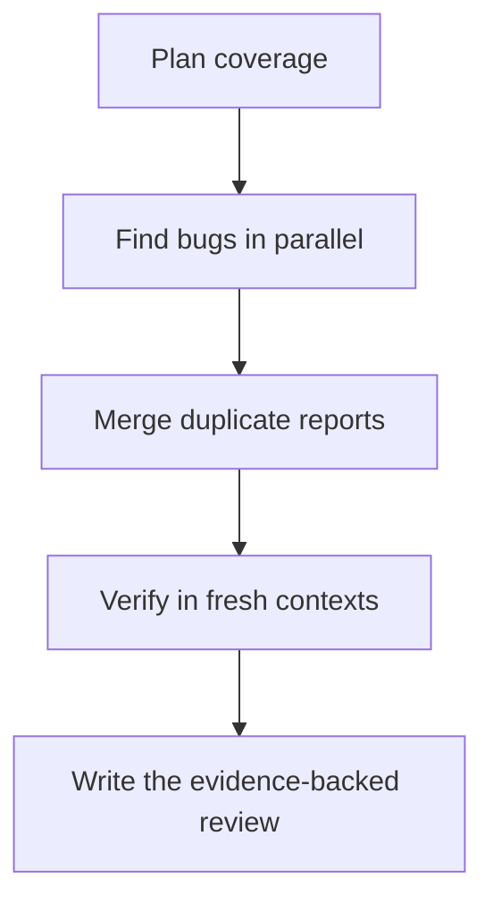

# OpenReviewKit

**Specialist code review using the Claude Code plan you already have.**

Open source, MIT licensed, with no separate reviewer subscription. Claude Code
quota and model-access limits still apply.

**Start here:** [Install](#install-the-skill) · [Copy-paste setup](#give-this-to-your-agent) ·
[Recall results](BENCHMARKS.md) · [How it works](.github/review/ROLES.md)

A standalone multi-pass reviewer for committed Git changes. It divides a change
among independent finders, combines duplicate candidates, verifies findings in
fresh contexts, and produces an advisory report. It includes larger-change model
tiering, bounded parallelism and incremental PR re-review.

## Install the skill

Run this in the project you want to review:

```sh
npx skills add juneadkhan/openreviewkit --agent claude-code --yes
```

For Codex, replace `claude-code` with `codex`. This installs the skill and its
implementation into your project; it does not run a review or call a model.
Open your agent in that project and ask:

> Use openreviewkit to set up the bundled reviewer for this repository. Run its
> offline demo, then prepare a dry-run against my intended base revision.

The skill adapts setup to your repository and preserves existing files. Live
reviews still require a signed-in Claude Code subscription, even when another
agent performs setup. The [setup prompt](SETUP-PROMPT.md) is available if you
prefer to give your agent the instructions directly.

## Give this to your agent

Copy this into Claude Code, Codex or your coding agent:

```text
Set up OpenReviewKit in this repository using:
https://github.com/juneadkhan/openreviewkit/blob/main/SETUP-PROMPT.md

Read those instructions and the bundled SKILL.md. Install the project-local
skill, run its offline demo, then prepare a dry-run against my intended base.
Preserve existing files and let me handle sign-in. Show the exact commits,
review plan and checks you actually ran before starting a live review.
```

The [full setup prompt](SETUP-PROMPT.md) is self-contained and tells your agent
how to fetch the implementation, inspect requirements and adapt to your repo.

## Recall results

**Historical internal pilot: 79/100 recall — 15 of 19 known defects found.**
The original configuration found all 5 known P1 defects and produced no false
blockers in 3 control changes. Two partial matches were excluded from recall.

That was a small, self-reported evaluation of the original implementation on one
private codebase, **not a measured recall score for this release**. OpenReviewKit
has since changed its policy and routing. The public synthetic smoke suite checks
end-to-end operation separately. Read [results and methodology](BENCHMARKS.md)
for the sample, scoring rules, repeat runs and limits.

## Download a versioned snapshot

For a fixed snapshot, download the [v0.2.1 release](https://github.com/juneadkhan/openreviewkit/releases/tag/v0.2.1)
and run the commands below from the extracted folder. The implementation and
its tests live together; no hosted service or background updater is required.



Architecture review and model-based deduplication run when applicable. An empty
candidate set skips verification. Failed or missing process records cannot be
presented as a clean review.

## Requirements

- Node.js 22.20+, Git and `tar` for local snapshot preparation.
- Claude Code 2.1.299 (the pinned candidate version), signed in with an eligible
  subscription for live review. No Claude installation is needed for the offline demo.
- Optional CI: GitHub Actions, GitHub CLI (included on standard Ubuntu runners),
  and a subscription OAuth secret configured by the repository owner.

No application checkout, database, specific framework, environment file or npm
dependency is required. The package has no install-time scripts.

## First result: offline demo

From this folder:

```sh
node scripts/demo.mjs
node --test tests/*.test.mjs
```

The demo creates a tiny repository in your temporary folder, removes an ownership
check in a second commit and prints the planned review assignments. It does not
pretend a model found the defect and makes no model/network call.

## Review your own change

```sh
node scripts/local-review.mjs --repo /path/to/project --base origin/main --dry-run
node scripts/local-review.mjs --repo /path/to/project --base origin/main
```

Choose your actual base branch. The reviewer uses the merge-base diff and an
archive of the selected committed head; uncommitted and untracked files are
excluded. It writes a separate temporary workspace and never modifies your
repository. Use `--out /path/to/new-directory` to retain a named workspace.

This edition refuses committed symlinks before model execution, including in CI,
so an archived link cannot expose a file outside the selected source snapshot.

Live execution first checks CLI subscription authentication. API/provider
environment variables are removed for the subprocess, with no API fallback.
`CLAUDE_BIN` can name your installed executable. `REVIEW_MAX_PARALLEL` is 1–16
(default 4). `REVIEW_TUNING` accepts a JSON tuning object based on
`config.example.json`; different model names need corresponding `effort` entries.
Changing models or reducing coverage can change recall and needs evaluation.

Results include `review.md`, `review-assessment.json`, `review-plan.json`, the
per-process `review-pipeline.json` and `review-work/evidence.json`. Exit status:
0 = no blockers; 1 = findings requiring attention; 2 = incomplete/failed review.
Review workspaces contain copies of your source: store and remove them accordingly.

## Install into a repository

```sh
node scripts/install.mjs --repo /path/to/project
```

The installer refuses an existing installation. After a local-first install, add
CI with `node scripts/install.mjs --repo /path/to/project --ci-only --default-branch main`.
Use your actual default branch. It creates
`.review/openreviewkit`; `--ci` additionally creates
`.github/workflows/openreviewkit.yml`. Review these local files before committing.
Bootstrap the reviewer folder onto the trusted default branch before enabling
the workflow; CI reads policy from that branch, so it cannot review its own first
installation. For a fresh combined installation, `--ci` writes both locally.
Generate your own subscription token with `claude setup-token` and put it in the
repository secret `OPENREVIEWKIT_OAUTH_TOKEN` yourself. Never paste it into chat.
The workflow skips forks and drafts, reads policy from the named trusted default
branch, reviews an immutable PR head, and refuses stale publication. It publishes
an advisory discussion comment; it does not approve, merge or change source.

To remove, delete the installed `.review/openreviewkit` directory and the optional
workflow you installed, and remove its GitHub secret yourself. No background
service, global package, hook or scheduler is installed by this bundle.

## Costs and boundaries

Subscription authentication uses your Claude quota. Multiple finders can consume
more quota than a single chat; usage limits and model availability still apply.
CI also consumes GitHub Actions runner minutes. This package is not unlimited
inference or a promise of equivalent performance to another review service.

Orchestration and reports run locally, but code excerpts and diffs are sent to
Claude through your account for model inference. Open-source orchestration does
not make that inference offline. Use it only with code you are authorized to
send through that account.

The reviewer can read source with Claude and look up public documentation. It
disables inherited settings, hooks and MCP servers, and does not execute project
code or tests. Source-local instructions are treated as untrusted evidence, not
review policy. Read-only tools are not an operating-system sandbox: filesystem
access and public-documentation requests are not confined by this package. Use
an isolated environment for untrusted repositories or stricter data boundaries.

Logs and reports can contain source or raw CLI diagnostics. Keep review
workspaces private; CI artifacts and comments follow your repository permissions.
Failure comments omit raw CLI errors rather than relying on credential-pattern
redaction. Review findings still include code evidence. Model errors and invalid
output remain incomplete, not clean.

## Release status

Release 0.2.1 adds real stage and process progress output. The local reviewer
writes timestamped operational updates to stderr while preserving report files
and exit codes. You can see coverage, process starts/retries/completions, candidate
merging and verification counts. Failed processes remain visibly incomplete.
Progress omits prompts, source, file paths, raw errors and custom model identifiers;
it is operational status, not a guarantee that every finding is correct.

The progress-enabled local path passed a fresh multi-file pagination regression
and a clean control using a real Claude Code subscription. See
[progress validation](validation/progress-smoke.json). The earlier two-case
[0.2.0 smoke results](validation/README.md) remain historical evidence, with their
original tested implementation hashes. Neither smoke set is a recall benchmark.
The optional GitHub Actions comment-delivery path and broader public-edition
recall remain unqualified. Installing from the public repository is a separate
check from running the optional CI integration.

To reproduce the tiny smoke set, prepare first, inspect it, then run the cases
serially. Live commands use subscription quota and are opt-in:

```sh
node scripts/e2e.mjs --out /path/to/new-smoke-directory
node scripts/e2e.mjs --out /path/to/new-smoke-directory --run --case regression
node scripts/e2e.mjs --out /path/to/new-smoke-directory --run --case control
```

The harness installs a fresh copy for each synthetic repository, proves the
fixture's runtime behavior, and keeps expected answers outside reviewed source.
It checks the exit status, final report, independent verification and every stage's
completion. A failed pilot stops before expansion; it never certifies recall.

OpenReviewKit is an independent open-source project and is not affiliated with Anthropic.
